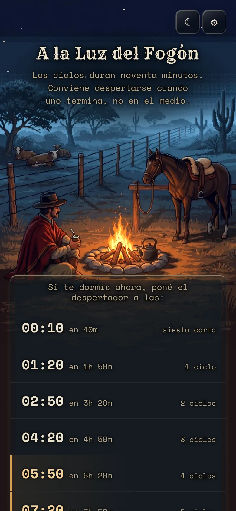
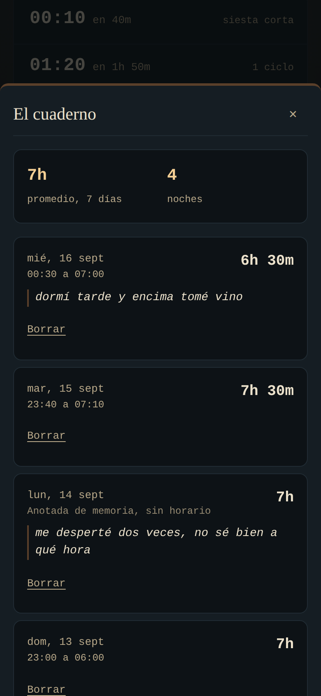
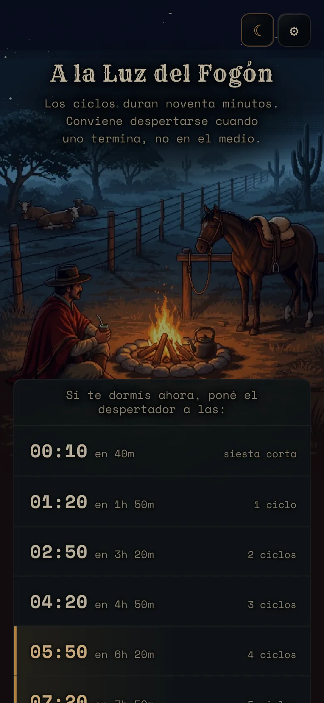
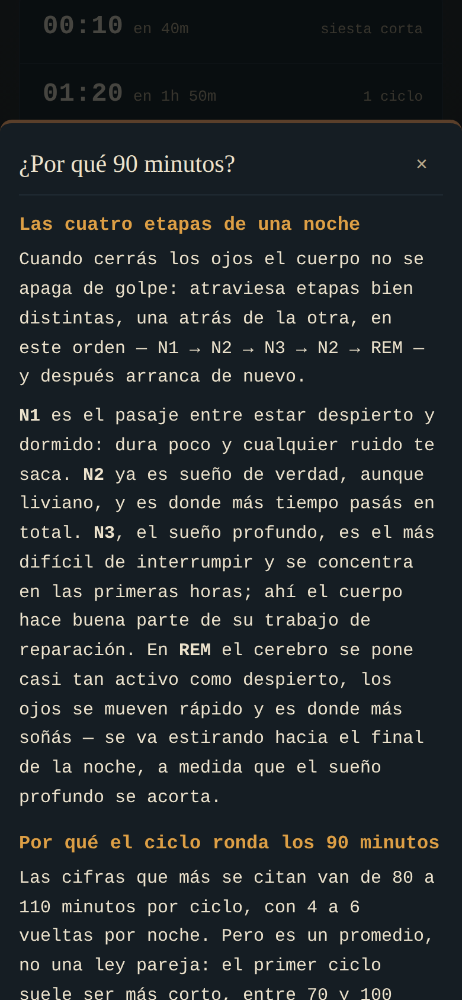
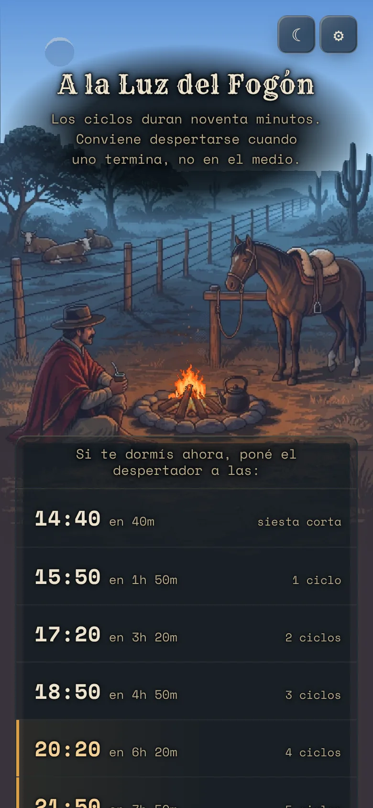

# A la Luz del Fogón

Una calculadora de ciclos de sueño. Le decís a qué hora te querés
levantar, o que te vas a dormir ahora, y te dice a qué hora poner el
despertador para no cortar un ciclo por la mitad.

**[Abrirla →](https://bruneskycoder.github.io/ciclo-de-sueno/)**

Una pantalla, un campo, y la respuesta más frecuente sin tocar nada: al
abrirla ya está calculada.



## Qué hace

**Calcula.** Los ciclos de sueño duran unos noventa minutos y conviene
despertarse cuando uno termina, no en el medio. La app parte de una hora
—la que le digas, o la de ahora mismo— y arma una escalera ordenada de
menos a más: la siesta corta primero, después uno, dos, tres ciclos. Al
lado de cada hora dice cuánto falta, que a la una de la madrugada es el
dato que importa.

**Anota, sin pedírtelo a la mañana.** El registro de sueño de la versión
anterior nunca se usó, y el motivo no era la cantidad de campos: era el
momento. Pedía completar un formulario a la mañana siguiente, y a la
mañana la app no se abre. Ahora, cuando entrás de noche a consultar, una
tarjeta pregunta por anoche: un toque si ya habías marcado que te ibas a
dormir, o cuántas horas dormiste si no. Después, una sola invitación
opcional: una línea sobre la noche.

**Guarda lo que escribís, no lo que calcula.** El cuaderno no es una
planilla. De todo lo que el formulario viejo pedía, lo único que aportaba
una persona era una frase; las horas las saca la app sola. Así que la
frase se lee como una cita y los números quedan de apoyo. Con
suficientes noches, el cuaderno muestra lo que se repite —cuánto se corre
el sueño el fin de semana, qué tan parejo es el horario— y cada cosa dice
sobre cuántas noches se apoya. Habla de "las noches en que", nunca de
"porque".



**Se puede mirar a oscuras.** El modo brasa no es un tema alternativo por
gusto: baja la luminancia total y frena el fuego, para cuando la abrís a
las tres de la mañana y no querés la pantalla en la cara. El botón
principal, que es el área de color más grande, pasa de emitir 0.66 de
luminancia relativa a 0.014.



**Dice lo que no sabe.** La premisa de la app —que despertarse al final
de un ciclo reduce la inercia del sueño— tiene buen respaldo pero no es
un hecho cerrado, y la página informativa lo dice con esas palabras, con
las fuentes al pie. Del mismo modo, una noche respondida de memoria se
muestra como _anotada de memoria, sin horario_, y no con un horario
inventado que parezca real.



## Cómo está hecha

Sin framework de UI y sin backend. Una sola dependencia en tiempo de
ejecución, [suncalc](https://github.com/mourner/suncalc), para la altura
del sol y la fase de la luna. Vite para el build, Vitest para los tests,
CSS plano, y `localStorage` para los datos.

La lógica vive en módulos **puros, sin DOM y sin `localStorage`**:
`calc.js` (la aritmética de los ciclos), `metrics.js` (los promedios) y
`sleep-session.js` (el estado de la noche en curso), y también las
cuentas de la escena: el viento, la llama, el cielo. Eso es lo que
permite tener 343 tests que corren en un segundo y medio sin levantar un
navegador. `storage.js` es la única capa que toca el almacenamiento, y no
importa ninguna vista: avisa que algo cambió y cada vista decide qué
repintar.

### La escena

El fondo es **una pintura de pixel art generada con IA** (Gemini), de
572 × 1024 píxeles: un claro del monte chaqueño de noche, con un gaucho
mateando junto al fogón, el caballo atado al palenque y tres vacas
echadas detrás del alambrado. El prompt está en
[`docs/escena-pintada.md`](./docs/escena-pintada.md). La pintura no se
mueve: el código la anima encima, en un canvas, sin librerías.

- **El fuego** se mueve en cuatro cuadros que salen de deformar la llama
  pintada, con brasas, humo y un resplandor que late. Con una noche en
  curso se va consumiendo: a la hora de levantarse quedan brasas.
- **El viento** corre las copas y el pasto de a píxeles enteros. Con
  fracciones de píxel, todo tiembla y parece un error de la imagen.
- **El cielo** es el de esa noche y ese lugar: las estrellas más
  brillantes en su posición real, con la Cruz del Sur, y la luna con su
  fase. Al atardecer, de día y al amanecer, la misma pintura se tiñe.
- **Las tarjetas** dejan ver la escena detrás. El borde que mira al fuego
  se calienta con su luz, y el canto de la lista dobla lo que tiene
  detrás, como un vidrio viejo.



Antes de la pintura hubo un intento en 3D con three.js, con los
personajes dibujados como texto. Se probó, se rechazó porque el dibujo no
daba, y se reemplazó por esto, que además pesa menos: la historia está en
[docs/proceso.md](./docs/proceso.md).

La lista de horas se dibuja primero. La escena llega después, cuando el
navegador tiene un respiro, y mientras tanto, o si no llega, queda una
escena chica de respaldo. La primera vez baja todo junto 177 kB: 52 kB de
JavaScript de la app (17 comprimido), 31 kB de la escena (14
comprimido) y 84 kB de la pintura. Lighthouse en modo teléfono: 94 a 99
de rendimiento y 100 de accesibilidad.

Es una PWA: se instala y funciona sin conexión a partir de la segunda
visita. El HTML de navegación va _network-first_ para no quedar sirviendo
una versión vieja después de un deploy; los bundles, que Vite nombra con
un hash de su contenido, van _cache-first_ porque su nombre es inmutable.

## Correrla

Requiere Node 18 o más nuevo.

```bash
npm install
npm run dev        # servidor de desarrollo
npm test           # los tests
npm run lint       # ESLint
npm run build      # build de producción en dist/
npm run preview    # servir el build
```

El deploy a GitHub Pages es automático en cada push a `main`, y corre
lint, tests y build antes de publicar.

## Tus datos

Viven en el `localStorage` de tu navegador y en ningún otro lado. No hay
servidor guardando nada, lo que también significa que borrar los datos
del sitio o cambiar de teléfono se lleva todo. En Ajustes hay export e
import en JSON: es el único respaldo que existe.

## Cómo se construyó

El autor no programa. La app está escrita orquestando Claude Code, el
agente de programación de Anthropic, y lo interesante no es que la IA
escribiera el código sino cómo se dirigió: tres rondas de entrevista
antes de planificar, un plan aprobado antes de tocar nada, y tres veces
en que el plan estaba mal y hubo que rehacerlo. Los commits que escribió
Claude lo dicen en la firma.

Eso está contado en **[docs/proceso.md](./docs/proceso.md)**, con los
errores incluidos. El plan vivo, con su registro de decisiones y de
desvíos, está en **[PLAN-v3.md](./PLAN-v3.md)**; el de la versión
anterior, en [PLAN.md](./PLAN.md).

## Fuentes

Los números no están inventados. La página informativa cita:

- [NCBI / StatPearls — Physiology, Sleep Stages](https://www.ncbi.nlm.nih.gov/books/NBK526132/)
- [NHLBI (NIH) — Stages of Sleep](https://www.nhlbi.nih.gov/health/sleep/stages-of-sleep)
- [Sleep Foundation — Stages of Sleep](https://www.sleepfoundation.org/stages-of-sleep)
- [Nature and Science of Sleep — Sleep inertia: current insights](https://www.dovepress.com/sleep-inertia-current-insights-peer-reviewed-fulltext-article-NSS)

Y para la siesta, [Sleep Foundation — Do Power Naps
Work?](https://www.sleepfoundation.org/sleep-hygiene/power-nap) y [Mayo
Clinic — Napping: Do's and
don'ts](https://www.mayoclinic.org/healthy-lifestyle/adult-health/in-depth/napping/art-20048319).

## Licencia

MIT — ver [LICENSE](./LICENSE).
